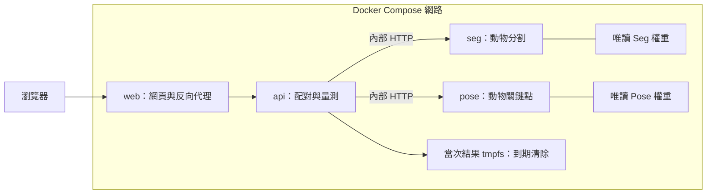

# 動物影像分割與眼距量測

## 1. 主題

使用 COCO 中含兩隻以上動物的圖片，透過 YOLO26n-seg 分割動物輪廓，並以 YOLO26n-pose 的 AP-10K 左右眼關鍵點，計算每隻動物雙眼距離及任兩隻動物右眼距離。

眼睛以關鍵點與提示框呈現，沒有眼睛分割遮罩，也不保證關鍵點為瞳孔中心。量測單位為原圖 px，尚未校正為真實長度；無效眼點不輸出距離。

## 2. 系統架構與架構圖

| 容器 | 職責 |
|---|---|
| web | Nginx 提供網頁，反向代理 API、範例與 API 文件 |
| api | 上傳、當次工作管理、模型整合、配對、眼點檢查及量測 |
| seg | 載入動物分割模型，輸出框、物種與 Mask |
| pose | 載入動物姿態模型，輸出框、物種與 17 個關鍵點 |



只有 Web 公開主機連接埠。API 不提供歷史列表；當次工作結果在完成／失敗後保留 RESULT_TTL_SECONDS（預設 1800 秒），到期清除狀態與檔案，查詢回傳 404。背景清理週期最長 30 秒，查詢已到期工作會立即刪除；執行中工作不會被 TTL 清除。Docker API 暫存使用 512 MiB tmpfs，重建容器即清除。實作尚無工作取消，模型 HTTP 請求 timeout 為 180 秒。

## 3. 部署方式：Dockerfile 與 docker.compose.yml

本次四容器部署固定使用 CPU。模型服務在 MODEL_DEVICE=cpu 時會強制 CPU 推論，網頁只提供 CPU 選項；基本映像安裝 CPU 專用 PyTorch。

### 檔案

```text
project/
├── docker.compose.yml
├── docker.compose.gpu.yml
├── .env.example
├── docker/
│   ├── web.Dockerfile
│   ├── api.Dockerfile
│   ├── model.Dockerfile
│   └── nginx.conf.template
├── metrology/
├── static/
├── models/
└── examples/
```

Seg／Pose 共用 model.Dockerfile，但各自啟動獨立容器與載入不同模型。Dockerfile 在建置階段自動安裝 requirements.txt，重新啟動不需重裝套件。

### 基本部署（CPU／Mac Docker）

先安裝並啟動 Docker Engine 與 Compose v2，在 project/ 執行：

```bash
# 尚無 .env 時，先從範本建立
cp -n .env.example .env
# 本次部署固定 MODEL_DEVICE=cpu
docker compose -f docker.compose.yml config --quiet
docker compose -f docker.compose.yml up -d --build
docker compose -f docker.compose.yml ps
docker compose -f docker.compose.yml logs -f api seg pose
```

使用獨立 Compose 的環境，將 `docker compose` 換成 `docker-compose`。第一次建置需下載套件，耗時依網路與主機而定。基本映像使用 CPU 專用 PyTorch，Docker 內另固定 OpenCV 4.11.0.86 以相容目前 ARM 虛擬 CPU。

預設 Web：[http://127.0.0.1:8080](http://127.0.0.1:8080)；[Swagger](http://127.0.0.1:8080/docs)。連接埠可在 .env 修改。CPU 四容器已完成實測，見 [部署驗證紀錄](docs/DOCKER_VERIFICATION.md)。

模型服務先載入權重並暖機，健康後啟動 API，API 健康後啟動 Web。模型啟動失敗時先檢查 logs；health=true 不取代實際圖片分析驗收。

### NVIDIA 主機

Linux 主機須先配置 NVIDIA 驅動與 Container Toolkit，且使用支援主機 GPU 的 PyTorch／CUDA 映像依賴。以下配置已提供，仍需在實際 NVIDIA 主機驗證：

```bash
docker compose -f docker.compose.yml -f docker.compose.gpu.yml up -d --build
```

本次不使用此 NVIDIA 配置。未來啟用時需另外將 MODEL_DEVICE 改為 auto 或 cuda，並驗證 CUDA 映像及硬體相容性；目前預設 cpu 會強制 CPU 推論。

### 停止與更新

```bash
docker compose -f docker.compose.yml down
# 修改依賴、程式或模型後重新建置／建立容器
docker compose -f docker.compose.yml up -d --build --force-recreate
```

原生 Python 開發可在 project/ 的 Python 3.11 環境安裝依賴後執行 `python run_local.py`（預設 127.0.0.1:8765，使用 PORT 環境變數調整）。此入口直接載入本地兩個模型；Docker 的四服務設定由 Compose 讀取 .env。

## 4. Requirements 與模型存放位置

Python 3.11；依賴見 [requirements.txt](requirements.txt)，包含 FastAPI、Uvicorn、python-multipart、Ultralytics、PyTorch、torchvision、NumPy、OpenCV、Pillow 與 httpx。

```bash
python -m pip install -r requirements.txt
```

| 模型 | 專案相對路徑 | 環境變數 |
|---|---|---|
| 動物分割 | ./models/animal_seg.pt | SEG_MODEL_PATH |
| 動物姿態／眼點 | ./models/animal_pose.pt | POSE_MODEL_PATH |
| 權重雜湊資訊 | ./models/manifest.json | — |

設定檔位於 project/.env；模型路徑相對於 project/，Compose 將對應權重唯讀掛載至模型容器：

```dotenv
WEB_BIND_HOST=127.0.0.1
WEB_PORT=8080
API_PORT=8000
SEG_PORT=8000
POSE_PORT=8000
MODEL_DEVICE=cpu
SEG_MODEL_PATH=./models/animal_seg.pt
POSE_MODEL_PATH=./models/animal_pose.pt
RESULT_TTL_SECONDS=1800
```

API_PORT、SEG_PORT、POSE_PORT 為各容器內部埠，可使用相同數值。模型服務 URL 由 Compose 按 port 組成，不需在瀏覽器設定。其他門檻設定見 [.env.example](.env.example)。不提交 .env；交付使用 .env.example。

## 5. API 清單與觸發分析

以 Docker 預設入口 http://127.0.0.1:8080 為例：

| 方法 | 路徑 | 說明 |
|---|---|---|
| GET | /api/health | 查詢兩模型服務健康與裝置 |
| GET | /api/samples | 取得 COCO 範例、ID 與來源 |
| POST | /api/jobs | **觸發分析**，202 回傳 id、queued |
| GET | /api/jobs/{job_id} | 查當次狀態；complete 包含 result，failed 包含 error |
| GET | /api/jobs/{job_id}/artifacts/{name} | 下載當次產物 |

POST 使用 multipart，sample_id 與 image 二擇一。介面仍接受 device=auto／cuda／mps／cpu，但本次部署固定 CPU；另可設定 conf（預設 .25）、eye_conf（.5）、match_iou（.3）。支援 JPG／PNG／WebP，預設 10 MiB、2,000 萬像素。同時只執行一筆；忙碌 409、過大 413、輸入錯誤 422、不存在／已到期 404。

```bash
# 選範例觸發分析：1818 斑馬、5992 羊群、7281 馬匹
curl -X POST http://127.0.0.1:8080/api/jobs -F sample_id=5992 -F device=auto
# 或上傳圖片，不能同時傳 sample_id
curl -X POST http://127.0.0.1:8080/api/jobs -F image=@/path/to/animals.jpg
# 將回傳 id 代入，查到 complete 或 failed
curl http://127.0.0.1:8080/api/jobs/WORK_ID
# complete 後下載
curl -o measurements.csv http://127.0.0.1:8080/api/jobs/WORK_ID/artifacts/measurements.csv
```

下載名稱：source.jpg、overlay.jpg、result.json、measurements.csv、animal_N_mask.png。無效距離 JSON 為 null、CSV 為空值。202 代表已接受，非已完成。API 無歷史列表或登入功能。

API 文件：[Docker Swagger](http://127.0.0.1:8080/docs) · [本地 Swagger](http://127.0.0.1:8765/docs) · [ReDoc](http://127.0.0.1:8080/redoc) · [OpenAPI](http://127.0.0.1:8080/openapi.json)。連接埠以實際部署設定為準。

模型內部介面（不對外）：GET /health、POST /predict，後者使用 multipart image、device、conf，回傳框、關鍵點、Base64 PNG 遮罩及裝置資訊。API 將原圖送至模型服務，不共用主機絕對圖片路徑。

## 6. 測試資料 CSV 路徑

[examples/test_cases.csv](examples/test_cases.csv)

```text
project/examples/
├── test_cases.csv
└── images/
    ├── 000000001818.jpg
    ├── 000000005992.jpg
    └── 000000007281.jpg
```

CSV 為測試輸入清單，列出三個案例的圖片相對路徑、來源、標註動物數與預期行為；不是量測真值或歷史紀錄。API 接收圖片或 sample_id，不直接接收此 CSV。

測試指令（在 project/、已安裝依賴的環境）：

```bash
python -m unittest discover -s tests -v
```
