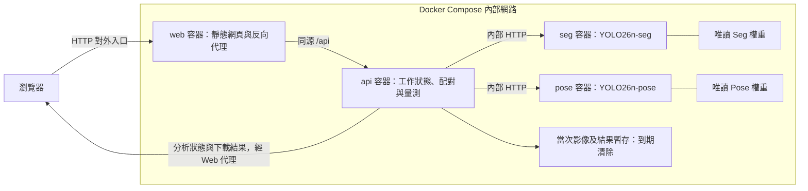

# 四容器系統架構

1. Web 提供頁面並將 `/api` 請求轉送 API。
2. API 接收圖片，管理當次工作並呼叫 Seg、Pose。
3. Seg 回傳動物框與遮罩，Pose 回傳物種、框及 17 個關鍵點。
4. API 執行物種與 IoU 配對、左右眼檢查、雙眼及跨動物右眼距離計算。
5. 網頁顯示結果，提供 JSON／CSV／標示圖下載，暫存到期清除。

共四個容器；不建立歷史列表、歷史資料庫或永久結果 Volume。暫存可採 API 容器 tmpfs，須限制容量並實作到期清理。服務重啟可清除當次狀態。

模型服務就緒後啟動 API，API 就緒後由 Web 提供入口。模型權重採唯讀掛載，模型服務與 API 不直接公開連接埠。NVIDIA GPU 需另配置裝置資源；無 GPU 使用 CPU。

已提供四服務 Compose 與 Dockerfile；原生入口仍保留單程序推論方式。部署驗證見 DOCKER_VERIFICATION.md。
